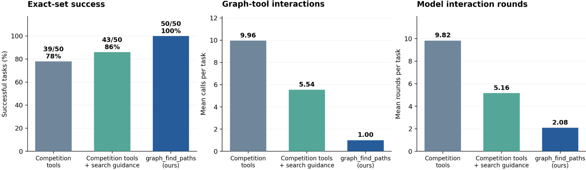

# code-graph-search-once

**Both tools work directly with Gemini CLI, Codex CLI, Claude Code, and OpenCode through MCP.**

An agent investigating a bug may know the failing function before it knows which helper to inspect. Use `graph_neighbors` to discover related symbols from that starting point. Once the agent picks a second symbol, use `graph_find_paths` to see every route between the two within a hop limit.

| What you know | Tool | Result |
|---|---|---|
| One exact symbol ID | `graph_neighbors` | Reachable symbols in breadth-first order. Each appears once with its shortest distance, parent symbol and the original edge row for that step. |
| Source and target IDs | `graph_find_paths` | All paths within the hop limit that never repeat a node. Paths share an evidence table that preserves every original edge row supporting each step. |

Both tools default to **4 hops** and accept **1–16**. Each result reports whether the search finished and whether the entire result fit in the response. The Python API and CLI run locally on your own graph JSON using only the standard library.

## Quick start

**Register one local MCP server to give your agent both tools.** Your client starts it over stdio and discovers `graph_neighbors` and `graph_find_paths`.

### Install and choose a graph

From this package's checkout, run the following in a macOS or Linux shell with **Python 3.10+** for MCP. Keep the virtual environment at this location so the agent can start it in future sessions.

```bash
python3 -m venv .venv
.venv/bin/python -m pip install '.[mcp]'
GRAPH_TOOL="$PWD/.venv/bin/code-graph-search-once"
GRAPH_FILE="$PWD/example_graph.json"
```

The included example is ready to query. To use your repository's code graph, set `GRAPH_FILE` to the absolute path of its existing [graph JSON](#graph-format) before registering. The client saves both paths and launches the tool whenever it connects.

### Register with your agent

In the **same shell**, change to the project where you use the agent. Run the block for your client.

**Gemini CLI** saves this entry in the current project's `.gemini/settings.json`. If Gemini prompts you to trust the project, confirm it for the workspace you intend to use. [Gemini CLI MCP guide](https://geminicli.com/docs/tools/mcp-server/)

```bash
gemini mcp add --scope project --transport stdio code-graph-search-once "$GRAPH_TOOL" -- --graph "$GRAPH_FILE" serve
gemini mcp list
```

**Codex CLI** registers the server in your user configuration. `codex mcp list` shows the saved entry. Open `/mcp` in a new Codex session to see the active tools. [OpenAI Codex MCP guide](https://developers.openai.com/codex/mcp/)

```bash
codex mcp add code-graph-search-once -- "$GRAPH_TOOL" --graph "$GRAPH_FILE" serve
codex mcp list
```

**Claude Code** uses a private registration scoped to the current project with `--scope local`. The second command checks its connection. [Claude Code MCP guide](https://code.claude.com/docs/en/mcp)

```bash
claude mcp add --transport stdio --scope local code-graph-search-once -- "$GRAPH_TOOL" --graph "$GRAPH_FILE" serve
claude mcp get code-graph-search-once
```

**OpenCode** accepts the same command on 1.19.5 and 2.x. On 1.19.5 it writes to user configuration. On 2.x it writes to the current project's configuration, and the agent can access the tools through Code Mode. For direct entries in the model's tool list on 2.x, set `codemode` to `false` on `mcp.servers.code-graph-search-once`. [OpenCode 1.19.5 registration](https://github.com/anomalyco/opencode/blob/v1.19.5/packages/opencode/src/cli/cmd/mcp.ts#L493-L521) · [OpenCode MCP guide](https://opencode.ai/docs/mcp-servers/#local)

```bash
opencode mcp add code-graph-search-once -- "$GRAPH_TOOL" --graph "$GRAPH_FILE" serve
opencode mcp list
```

### Try both tools

Start a new agent session in the configured project. With the included example graph, ask:

> Use `graph_neighbors` from anchor `a`. Which symbols are within two hops? Then use `graph_find_paths` to show every path from `a` to `t` within four hops.

The neighborhood contains `b` and `c` at distance 1, then `t` and `d` at distance 2. The entry for `t` names `b` as its parent and points to the stored edge `b → t`. The path query returns both `a → b → t` and `a → c → d → t`. Clients may prefix the two tool names with the server name.

You can also run the same queries directly from the shell:

```bash
"$GRAPH_TOOL" --graph "$GRAPH_FILE" neighbors --anchor a --max-hops 2 --decode
"$GRAPH_TOOL" --graph "$GRAPH_FILE" query --source a --target t --max-hops 4 --decode
```

For Python or CLI use alone, Python 3.9+ and `python -m pip install .` are sufficient.

## Gemma-4-31B results

The two evaluations use the same 50 symbol pairs from Rich, FastAPI and Requests. They compare the tools here with graph tools from the [Gemma 4 developer-agent competition](https://www.kaggle.com/competitions/gemma-4-developer-agent/overview).

### When both endpoints are known

Gemma was asked to submit every simple path of up to four edges. With `graph_find_paths` it submitted the exact set on **50/50** questions, averaging **1.00 graph query** and **2.08 model rounds** per task. With the competition's `get_code_neighbors` and `get_code_subgraph` it solved 39/50, rising to 43/50 with search guidance.



See the [results and second figure](benchmark50/README.md#gemma-4-31b-results) and the [original prompts, tool selections and budgets](benchmark50/README.md#experiment-prompts-and-tool-configuration).

### When only the starting symbol is known

In the reported hidden-target experiment, Gemma received only the starting symbol. A hit means the exact destination ID appeared in a tool response delivered to the model. Both tools had a four-hop search radius and a total allowance of 12,000 JSON characters per task. Gemma could make up to eight one-hop queries with `get_code_neighbors` or one query from the starting symbol with `graph_neighbors`.

| Graph tool | Hidden target returned | Mean graph queries/task | Mean model tokens/task |
|---|---:|---:|---:|
| Competition `get_code_neighbors` | 24/50 (48%) | 5.40 | 7,571 |
| `graph_neighbors` | **41/50 (82%)** | **1.00** | **5,490** |

The single query reached all 24 targets found with the competition tool and 17 more. On FastAPI question `expanded-024`, the parent links show how the agent reached the hidden symbol three hops from its starting point (all four symbols are in `fastapi.routing`).

```text
APIWebSocketRoute.matches → APIWebSocketRoute → APIWebSocketRoute.__init__ → websocket_session
```

## Competition repair tasks

A separate study reported successful repairs on **7/10** competition tasks with `graph_neighbors` and `graph_find_paths` together, compared with **5/10** using the competition graph tools. Mean graph queries per task fell from 2.60 to 1.30, and total tokens across the ten tasks fell from about 257,000 to 195,000.

## Reproduce the 50-question study

The [benchmark50 guide](benchmark50/README.md) includes the fixed 50 questions, 142 reference paths, original competition-tool adapters, frozen prompts, isolated Python execution, a configurable model runner, and evidence-based grading. Its verified deterministic controls recover all 50 exact path sets: 6.46 mean graph queries with the competition tools plus a search program, and 1.00 with `graph_find_paths`.

Run the benchmark on your existing competition graphs, or fetch the exact files using its SHA-256 asset manifest. Model execution requires an explicit connection configuration and `--execute`.

For the hidden-target task, replay the default `graph_neighbors` query on each original graph. The script checks all 50 responses against their frozen fingerprints and verifies that 41 contain the hidden destination.

```bash
.venv/bin/python scripts/check_neighbors50.py /path/to/graphs
```

## CLI options

Add `--decode` to print the decoded node sequences instead of the full packet. Repeat `--source` or `--target` for multiple endpoints. `--sha256` is optional in this convenience CLI: omitting it pins the bytes of the supplied file; providing it checks against your expected asset digest.

```bash
.venv/bin/code-graph-search-once --graph /absolute/path/my-graph.json \
  --max-paths 5000 --output-limit 100000 \
  query --source package.entry --target package.target --max-hops 16
```

For one anchor, use `neighbors`. Pass `--output-limit` **after** the subcommand to set the character budget for that response. Repeat `--relation-type` to include several stored edge types.

```bash
.venv/bin/code-graph-search-once --graph example_graph.json \
  neighbors --anchor t --direction upstream --max-hops 8 --relation-type stored --output-limit 32000
```

The standalone `run_graph_find_paths.py` adapter and native factory require an explicit expected SHA256, matching the supplied reproduction protocol.

```bash
python3 run_graph_find_paths.py --graph example_graph.json \
  --sha256 92d0a209b67517b701256a3242f87b58016e83e7665f0e433c7c8f2c0cdc7d2f \
  --sources a --targets t --max-hops 4
```

## Python API

```python
from code_graph_search_once import GraphRuntime, decode_paths

with GraphRuntime("example_graph.json") as graph:
    packet = graph.query(source_nodes=["a"], target_nodes=["t"], max_hops=4)
    print(decode_paths(packet))
    print(packet["search_complete"], packet["output_complete"], packet["complete"])
```

Both tools can query the same loaded graph. In this example, `b` and `c` are one stored edge downstream of `a`. The first witness for `b` is edge row 0, from `a` to `b`.

```python
from code_graph_search_once import GraphRuntime, decode_neighbors, get_neighbors_schema

with GraphRuntime("example_graph.json") as graph:
    packet = graph.graph_neighbors("a")
    rows = decode_neighbors(packet)["candidates"]
    print([(r["node_id"], r["distance"], r["via"]["row_index"]) for r in rows])
    # [('b', 1, 0), ('c', 1, 2), ('t', 2, 1), ('d', 2, 3)]
    larger = graph.graph_neighbors("a", max_hops=8, output_limit=32_000)
    paths = graph.query(["a"], ["t"], 4)
```

`graph_neighbors` starts at an exact node ID and defaults to 4 hops (range 1–16). Downstream follows stored `source` to `target`. Upstream follows the reverse direction and preserves the original orientation and attributes in `via.row`. Each reachable symbol appears once, with the anchor excluded. The graph-only input gives `source_location` a value of `null`. `relation_types` filters on case-sensitive `type` values. An omitted filter allows all types and an empty list matches none.

The default output limit is **12,000 characters in `json.dumps(packet)`**, with a minimum of 4,096. The compact packet contains a prefix of the BFS results that fits the budget. `decode_neighbors` expands that prefix for inspection and can produce more text. `search_complete` reports whether the bounded search finished. `output_complete` reports whether the packet includes every retained candidate and the query details. Use `complete` to decide whether the returned neighborhood is exhaustive for that anchor, direction, filter and hop bound. For an unknown ID, inspect `anchor_resolution.status` for `NodeNotInGraph`.

The native factory and session are also available directly:

```python
from code_graph_search_once import AllPathsSession, make_graph_find_paths

query = make_graph_find_paths(
    "example_graph.json",
    "92d0a209b67517b701256a3242f87b58016e83e7665f0e433c7c8f2c0cdc7d2f",
    max_paths=100000,
)
packet = query(source_nodes=["a"], target_nodes=["t"])  # default max_hops=4
```

The public native signature remains:

```python
graph_find_paths(source_nodes: list[str], target_nodes: list[str], max_hops: int = 4) -> dict
```

Native constructor/query validation raises `ValueError`; filesystem failures raise `OSError`. The Python wrapper preserves those errors. Its context manager releases the local session on exit.

## MCP integration

The [Quick start](#register-with-your-agent) has registration commands for the four CLIs. For another client that reads an `mcpServers` JSON object, set the executable and the graph to their absolute paths.

```json
{
  "mcpServers": {
    "code-graph-search-once": {
      "command": "/absolute/path/code-graph-search-once/.venv/bin/code-graph-search-once",
      "args": ["--graph", "/absolute/path/my-graph.json", "serve"]
    }
  }
}
```

The stdio server exposes `graph_find_paths` and `graph_neighbors`. Their advertised parameters and descriptions come from the [path schema](tool_schema.json) and [neighborhood schema](variants/graph-neighbors/tool_schema.json). Each successful call returns `json.dumps(packet)` as MCP text. An unknown anchor produces a regular neighborhood packet. Invalid arguments produce a transport error (`isError=true`). Both tools use the graph selected by the host, with fresh work counters for each query.

## Graph format

```json
{
  "nodes": [{"id": "a"}, {"id": "b"}, {"id": "t"}],
  "edges": [
    {"source": "a", "target": "b", "type": "calls", "file": "app.py"},
    {"source": "b", "target": "t", "type": "calls", "line": 12}
  ]
}
```

- Unique nonempty string node IDs, with every edge endpoint declared in `nodes`.
- Exactly one of `edges` or `links`; arbitrary extra attributes are retained in edge evidence.
- At most 16 MiB, 20,000 nodes and 100,000 edge rows; strict JSON parsing rejects duplicate object keys and non-finite numbers.
- Path queries accept one to three sources and one to eight targets. Exact IDs take precedence over unique suffix matches; ambiguous inputs stay unresolved.
- Path enumeration uses stored **undirected adjacency**. Reciprocal/parallel rows share one relation and retain all their original evidence without duplicating node sequences.
- Paths never repeat a node. A source equal to its target yields a zero-edge path. DFS follows lexical neighbor order; shorter and longer alternatives are both included within the bound.

Use a trusted expected hash when checking a graph against an external asset manifest. Sessions load an immutable snapshot; create a new session after updating the graph file.

## Path query budgets and completeness

| Host option | Default | Applies to |
|---|---:|---|
| `max_edge_rows` / `--max-edge-rows` | 2,000,000 | Original edge-row examinations per invocation |
| `max_dfs_states` / `--max-dfs-states` | 500,000 | DFS function entries per invocation |
| `max_paths` / `--max-paths` | 100,000 | Paths found across distinct ordered-pair searches |
| `output_limit` / `--output-limit` | 1,000,000 | Characters in `json.dumps(packet)` |

Search limits are nonnegative integers; output limit is an integer of at least 4096. Boolean values are rejected. All source/target pairs in one call share these budgets; repeated resolved ordered pairs reuse the same search. Reverse-direction pairs are distinct. Target-distance BFS prunes the DFS enumeration.

Each pair reports `found_count`, `returned_count`, `search_complete`, `output_complete`, and `complete`. The packet reports the same three completeness flags for the whole call. A returned path is supported even if more paths remain to be searched or delivered. Exhaustiveness requires `complete=true`. Truncation reasons identify the exhausted edge, DFS, path or output budget. A complete zero-result search has `status="no_path"`; interrupted searches remain `incomplete`, and unresolved endpoints remain `unresolved`.

## Decode the path packet

`pairs` is a source-major grid. Each path's `nodes` indexes the shared `nodes` table, and its `edges` indexes the shared `edges` table. Each evidence entry preserves the original row index and full parsed row, including orientation and custom attributes.

```python
for pair in packet["pairs"]:
    for path in pair.get("paths", []):
        symbols = [packet["nodes"][i] for i in path["nodes"]]
        evidence = [packet["edges"][i]["rows"] for i in path["edges"]]
        print(symbols, evidence)
```

Use `pair.get("paths", [])`: output bounding may compact empty pair records and resolution metadata. Completeness flags describe the delivered result in every resolution mode.

## Project layout and verification

- `variants/graph-find-paths/`: path search tool, schema and twelve supplied tests.
- `variants/graph-neighbors/` contains the single-anchor search kernel and its schema.
- `exports/graph-find-paths/frozen/decision_lab/graph_native_v1/core.py`: exact pinned graph loader/resolver required by the tool.
- `run_graph_find_paths.py`, `example_graph.json`: supplied executable example.
- `code_graph_search_once/`: installable Python API, CLI and optional MCP transport.
- `tests/`, `scripts/`: integration checks for the package and transport.

The Python package verifies the bundled source for both tools when loaded. The tools share the same graph loader.

```bash
python3 -m unittest discover -s variants/graph-find-paths -p 'test_*.py' -v
python3 -m unittest discover -s tests -v
# With the optional MCP extra installed:
python3 scripts/check_mcp.py
```
